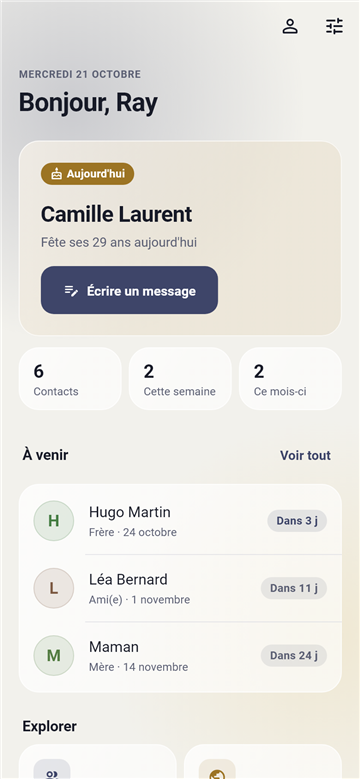
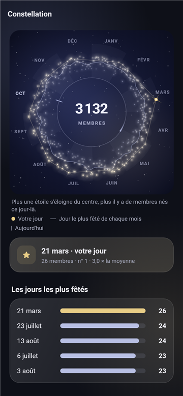
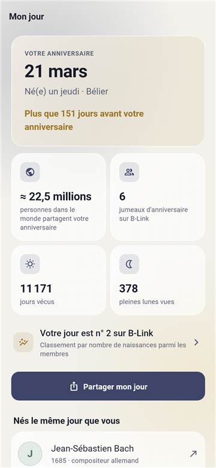
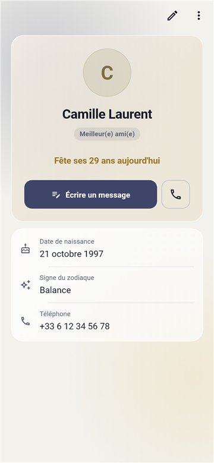
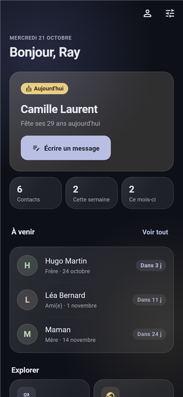
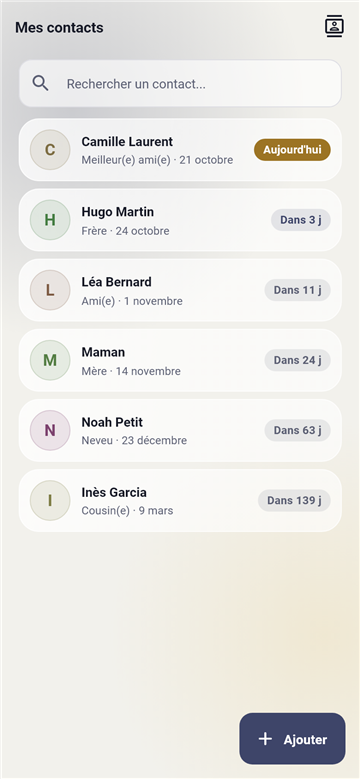
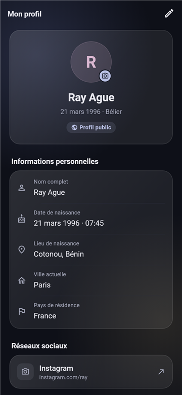
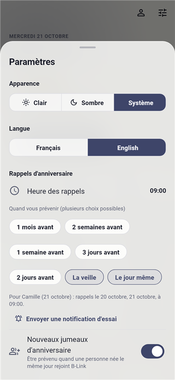

# B-Link

**Retrouvez les personnes nées le même jour que vous, et n'oubliez plus
jamais l'anniversaire de vos proches.**

Application mobile **Flutter** (Android, iOS) avec **Firebase**. Interface en
français et en anglais, thèmes clair et sombre.

<p>
  
  
  
  
</p>

## Sommaire

- [Fonctionnalités](#fonctionnalités)
- [Captures d'écran](#captures-décran)
- [État du projet](#état-du-projet)
- [Démarrer](#démarrer)
- [Tests](#tests)
- [Déploiement](#déploiement)
- [Architecture](#architecture)
- [Documentation](#documentation)

## Fonctionnalités

### Vos proches

| | |
|---|---|
| **Rappels** | Notification à l'heure choisie, du jour même à un mois avant (veille, 2 ou 3 jours, 1 ou 2 semaines, 1 mois), au choix. |
| **Import du carnet** | Les contacts qui ont un anniversaire sont cochés d'office ; une date se donne en un geste aux autres. |
| **Messages** | 154 messages écrits à la main par langue, selon la relation (ami, mère, conjoint…), jamais deux fois le même tant qu'il en reste. |
| **Envoi** | Directement sur **WhatsApp**, en copie, ou en **carte image** à partager. |
| **Carnet du téléphone** | La fiche d'un contact s'enregistre dans les contacts du téléphone en un geste. |

### Vos jumeaux d'anniversaire

| | |
|---|---|
| **Même jour** | Annuaire volontaire des personnes nées le même jour (ou la même semaine, le même mois), dans le monde, votre pays ou votre ville. |
| **Aujourd'hui dans le monde** | Les membres dont c'est l'anniversaire ; on leur envoie un **vœu** parmi 30 messages, jamais un qu'ils ont déjà reçu. |
| **Mur de vœux** | Le jour J, tous les vœux reçus de vos jumeaux, avec une notification à chaque nouveau vœu. |
| **Mon jour** | Ce que votre date a d'unique, les **personnalités nées le même jour** (Wikipédia), une carte à partager. |
| **Constellation** | Chaque jour de l'année est une étoile, d'autant plus brillante que des membres y sont nés : jours les plus fêtés, homonymes, prénoms les plus portés. |
| **Rencontres** | Entre jumeaux d'une même ville, avec des conseils de sécurité. |

### Confiance

- Profil **privé par défaut** ; chaque information publique est choisie une à
  une ; annuaire réservé aux **16 ans et plus**.
- Signalement et blocage ; masquage automatique après 3 signalements
  distincts ; écran de modération pour les admins.
- Statistiques d'utilisation **seulement avec consentement**, jamais reliées
  au compte.
- Suppression du compte depuis l'app ou depuis le site.

## Captures d'écran

| Accueil (sombre) | Contacts | Profil | Réglages des rappels |
|---|---|---|---|
|  |  |  |  |

Captures générées par le banc de tests, avec des données d'exemple.

## État du projet

| Élément | État |
|---|---|
| Application Android | ✅ Compile en release, connexion Google configurée (clé de développement) |
| Règles Firestore et Storage, index | ✅ Déployés |
| Cloud Functions (9) | ✅ Déployées, nettoyage automatique des images activé |
| Site (accueil, confidentialité, suppression de compte) | ⏳ En attente du nom de l'éditeur et d'une adresse de contact |
| Clé de publication Android | ⏳ À créer, puis ses empreintes à ajouter dans Firebase |
| Google Play | ⏳ Ajouter l'empreinte de la clé de signature Google Play dans Firebase |
| iOS | ⏳ Mac requis, `GoogleService-Info.plist`, connexion Apple (exigée par l'App Store), clé APNs |
| Tests sur de vrais téléphones | ⏳ À faire |

## Démarrer

Prérequis :

- Flutter 3.47 (Dart 3.13)
- JDK 17 pour les builds Android (Android Gradle Plugin 9.1)
- Node 22, JDK 21 et `firebase-tools` pour les Cloud Functions et les émulateurs

```bash
flutter pub get
flutter run
```

Construire un APK de test (signé avec la clé de développement tant qu'aucune
clé de publication n'est configurée) :

```bash
flutter build apk --release
```

## Tests

| Quoi | Commande |
|---|---|
| Analyse et tests de l'app | `flutter analyze` puis `flutter test` |
| Cloud Functions | `cd functions && npm ci && npm test` |
| Règles Firestore et Storage (émulateur, JDK 21) | `cd test_rules && npm ci && npm test` |
| Tests de fumée sur un appareil branché | `flutter test integration_test` |

## Déploiement

```bash
scripts/deploy_prod.sh b-link-3b2d5
```

Le script vérifie d'abord les règles sur l'émulateur, puis déploie règles,
index, Storage, Functions et site. À savoir :

- forfait **Blaze** obligatoire (Storage, Cloud Functions, tâche planifiée) ;
- les règles Storage lisent Firestore : le compte de service de Storage doit
  avoir le rôle `firebaserules.firestoreServiceAgent` (la CLI le propose lors
  d'un déploiement interactif) ;
- règles, index, Functions et app vont ensemble ;
- le premier `super_admin` se crée hors de l'app (console ou script Admin
  SDK), les suivants avec la fonction `grantAdmin`. Aucun identifiant dans le
  dépôt.

## Architecture

### Données (Firestore)

| Collection | Rôle |
|---|---|
| `users/{uid}` | Profil complet, **privé**. Sous-collections `contacts`, `blocks`, `devices` (jetons push). |
| `public_profiles/{uid}` | Projection publique : seulement les champs que la personne montre. |
| `wishes/{uid}/received/{expéditeur}_{année}` | Vœux reçus : message prédéfini, un par expéditeur et par an, lisibles par le seul destinataire. |
| `wishes/{uid}` | Numéros des messages déjà reçus dans l'année, écrit par le serveur. |
| `events/{id}` (+ `attendees`) | Rencontres entre jumeaux d'une même ville. |
| `reports/{id}`, `moderation/{uid}` | Signalements et décisions de modération. |
| `app_stats/constellation` | Agrégats anonymes : naissances par jour, prénoms et noms portés par au moins 3 profils. |
| `admins/{uid}` | Rôles admin, créés côté serveur. |

Règles de sécurité : [`firestore.rules`](firestore.rules) et
[`storage.rules`](storage.rules).

### Cloud Functions

[`functions/index.js`](functions/index.js) (Node 22) : nettoyage complet à la
suppression d'un compte, masquage par signalements, notifications « nouveau
jumeau » et « vœu reçu », recalcul de la constellation toutes les 6 heures.

### Application (`lib/`)

| Dossier | Contenu |
|---|---|
| `theme/` | Système de design : grille de 4, rayons, typographie, couleurs du logo, verre dépoli. |
| `widgets/ui/` | Composants communs : `AppScaffold`, `GlassCard`, feuilles, badges, champs. |
| `screens/` | Écrans : accueil, contacts, Même jour, Mon jour, constellation, vœux, profil… |
| `services/` | Firestore, SQLite, rappels, carnet du téléphone, Wikipédia, vœux. |
| `providers/` | État : profil, contacts, langue, thème, authentification. |
| `l10n/` | Textes français et anglais. |

## Documentation

- [Rappels en arrière-plan](Docs/BackgroundReminders.md)
- [Build Android et signature](Docs/Android.md)
- [iOS](Docs/iOS.md)
- [Publication](Docs/RELEASE.md)
